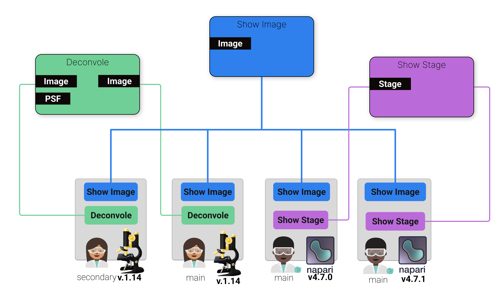
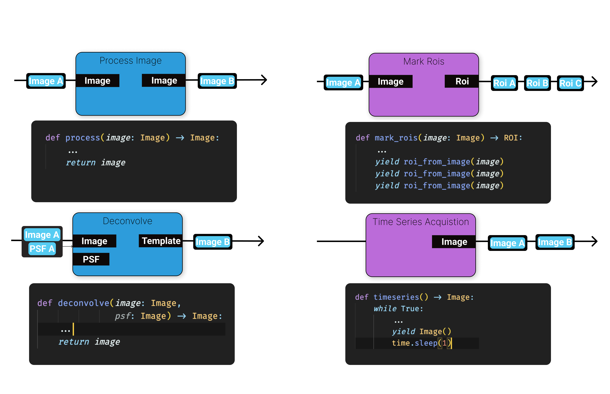

Everything that does work in Arkitekt is an **app**. What an app can do is described as **actions**, and the copies of an app that are running right now are its **agents**. This page explains the four terms and how they fit together.

## How the terms relate [#how-do-these-elements-relate]

| Term | Is | Example |
|---|---|---|
| **Action** | *what* can be done, defined by its inputs and outputs | "Segment Cells: Image → LabelMask" |
| **App** | a program that can offer implementations | the `stardist` plugin, version 0.3 |
| **Implementation** | *how* an app does an action | stardist's `segment_cells` function |
| **Agent** | a running instance of an app that serves its implementations | stardist running on the GPU server |
| **Task** | one run of an action, routed to an agent | "segment image 42", started by you at 10:14 |

An action is an abstract contract. Apps implement it, agents are running copies of those apps, and
a task is one call that the hub routes to an agent. You assign a task to an action, never to a
machine, so the call keeps working when the app behind it changes.

## What is an app? [#what-is-an-app]

An app can be Orkestrator, Fiji with the Arkitekt plugin, a website, a Python script, a robot or a
sensor. Any code that reads or writes your data has to be an app, because the hub only answers
authenticated apps. The first time an app connects, you approve it and the
permissions (scopes) it asks for through OAuth2, the flow behind "log in with Google". From then on
the hub knows which app, in which version, acts for which user. Apps are
[versioned](/docs/get-started/deployment/versioning) independently of the hub.

An app may expose actions, but it does not have to: an app that only displays data is still an app.
Standalone apps and plugins are described in [Apps](/docs/guides/apps).

## Apps vs services [#apps-vs-services]

**Services** are the parts the hub is built from: [Rekuest](/docs/develop/internals/rekuest),
[Mikro](/docs/develop/internals/mikro), [Fluss](/docs/develop/internals#fluss) and the others. They
store and retrieve data and route work, but they do no analysis and are not used directly by people.
**Apps** do the analysis, and use services to read inputs and store results. An app lists the
services it requires in its [manifest](/docs/develop/reference/manifest), you see them when you approve it,
and it only works with a hub that runs them.

## What is an action? [#what-is-an-action]

An action is something the platform can do for you, defined only by its typed inputs and outputs,
its [ports](/docs/concepts/workflows#port). It can be a computation (a maximum projection, a Gaussian filter) or a request to
a person (select a file, label an image).

An action is not bound to an implementation: Fiji and napari can each implement the same "Show"
action their own way. Callers depend only on the action, so you can pick the app you prefer, and a
developer can change an app's code without breaking callers while the inputs and outputs stay the
same.

### Actions can stream [#action-can-establish-streams]

A function action returns one result. A generator action **yields** results over time, and each one
reaches the caller as soon as it is produced. In a [workflow](/docs/concepts/workflows), the next node starts on the
first item instead of waiting for the last, which is what lets a workflow process images while they
are still being acquired.

## What is an implementation? [#what-is-an-implementation]

ImageJ, napari and a Python script could each do "Maximum Intensity Projection" differently; each
is an implementation of that one action. Implementations always belong to an app, and exist per user
who runs it, which lets the platform pick the best fit for a task.

As a developer you rarely deal with either term. When you decorate a function with `@app.action`,
the SDK reads its signature and docstring and declares the implementation. If no matching action
exists yet, the hub creates one.

## Agent [#agent]

An agent is the process that holds a connection to Rekuest, receives tasks, runs them and reports
back. `arkitekt run` on your laptop is an agent, and so is a plugin container started by Kabinet or a
Qt application with a connected MagicBar. One app can run as several agents, on different machines or
for different users, and the platform picks one when it routes a task. An agent also owns the app's
live [state](/docs/develop/python/state-lifecycle).

When an agent dies, its running tasks end [lost](/docs/concepts/tasks#states), except workflow tasks, which the next
process resumes from the agent's journal. A restarted agent keeps its name. See
[Durable execution](/docs/develop/patterns/durability).

<Callout type="info" title="Not an AI agent">

An AI assistant that calls actions is a *caller*, like a person or a script. "Agent" on its own
always means a running app instance.

</Callout>
