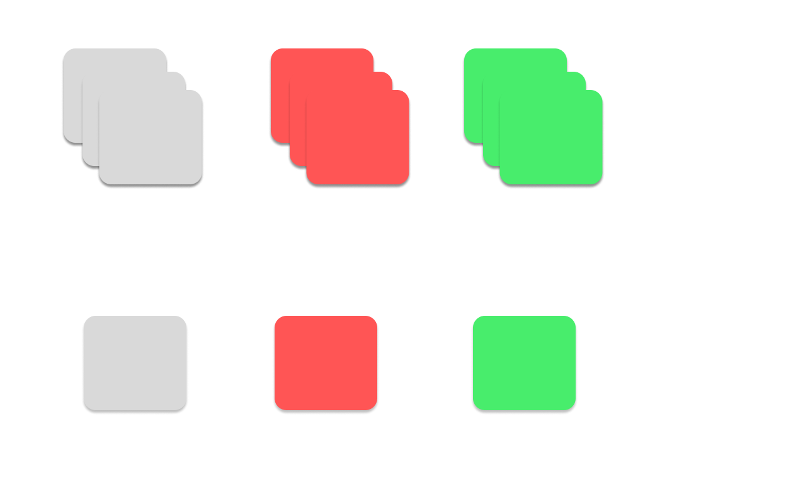

We like Nextflow. It is one of the best workflow engines written for science, and Arkitekt learned
from it. Both run tasks across varied hardware, wire data from one task to the next and aim for
reproducible results. They make different design choices, and each fits its own kind of work.

## Python instead of a DSL [#programming-primitives-vs-a-dsl]

Nextflow has its own language, a Groovy dialect with `process`, `channel` and operators. It is well
designed, but it is a language to learn and a boundary to cross when your logic outgrows it.

In Arkitekt an action is a decorated Python function. Type hints become its input and output
[ports](/docs/concepts/workflows#port), and the docstring becomes its description:

```python
from arkitekt import App
from mikro.arkitekt.specs import Image, LabelMask

app = App("stardist", "0.1.0")


@app.action
def run_stardist(image: Image) -> LabelMask:
    """Run StarDist

    Runs StarDist segmentation on a single image.
    """
    ...
```

You orchestrate actions in an [`@app.workflow`](/docs/develop/python/workflows) with ordinary Python:
loops, conditionals, `async`/`await`, exceptions and your own helpers. A branch on a measured value
or a loop until convergence is plain code. Such a workflow is also
[durable](/docs/develop/patterns/durability): if its process dies, it resumes without redoing the
steps that finished.

For people who do not want to write code, Orkestrator has a graphical workflow designer. The same
actions appear as blocks you wire together, and both kinds of workflow call actions the same way.

## Execution model [#execution-model]

A Nextflow task runs in a shell and exits when it is done, taking its state with it. An Arkitekt app
is a long-running agent that keeps its state and talks to other apps through messages.

```groovy
params.images = "./images/*.tif"

process RunStarDist {
    input:
    path image

    output:
    path "segmented_${image.baseName}.tif"

    script:
    """
    stardist segment ${image} -o segmented_${image.baseName}.tif
    """
}

process CalculateMaximum {
    input:
    path segmented

    output:
    path "max_values.txt"

    script:
    """
    your_analysis_tool ${segmented} > max_values.txt
    """
}

workflow {
    Channel.fromPath(params.images) | RunStarDist | collect | CalculateMaximum
}
```

Each image that reaches `RunStarDist` starts a new OS process. StarDist starts, loads its model onto
the GPU, segments one image and exits. In Arkitekt the `run_stardist` agent stays up, so the model
loads once and every image is processed in the same process. The gap grows when setup is expensive,
for example when each task on a cluster also has to start a container.

<Callout type="warn">

Staying resident has its own cost. A memory leak in a long-running app grows with every item, while
a Nextflow process frees its memory when it exits.

</Callout>

### The model problem [#the-model-problem]

Deep-learning models make the difference largest. Importing the framework, allocating GPU memory
and loading weights can take seconds to tens of seconds. In Nextflow that cost is paid once per
task, so ten thousand frames pay it ten thousand times, unless you run a separate model server next
to the pipeline.

In Arkitekt the model lives in the app's context, built once by a startup hook and injected into
every call:

```python
from dataclasses import dataclass

import xarray as xr

from arkitekt import App
from mikro import Mikro
from mikro.arkitekt.specs import Image

app = App("inference", "0.1.0")


@app.context
@dataclass
class Model:
    net: object


@app.startup
def load() -> Model:
    return Model(net=load_my_model())  # paid once, when the agent starts


@app.action
def run_inference(image: Image, model: Model, mikro: Mikro) -> Image:
    """Run Inference"""
    result = model.net.predict(image.data)  # the warm model, every call
    dataset = mikro.create_array_dataset(
        data=xr.DataArray(result, dims=image.data.dims),
        scales=[],
        name="inference result",
        axes=image.carried_axes(image.data.dims),
    )
    return dataset.lens()
```

A context holds private, long-lived resources. `@app.state` is for values you publish to the
platform, and a model does not belong there (see
[State & lifecycle](/docs/develop/python/state-lifecycle)).

This is why the two tools suit different work. Nextflow is built for large batches where startup
time does not matter. Arkitekt is built for items that arrive one at a time and need a fast answer,
as in smart microscopy, where the result of one frame steers the next acquisition.

<figure className="my-6 w-full">



<figcaption className="mt-2 text-sm text-fd-muted-foreground">The time to feedback (results of a single run of your workflow)</figcaption>
</figure>

You can still use either tool for either kind of work. An Arkitekt action can run a shell command
and return, which is Nextflow's model.

## Scaling out

Nextflow scales by fanning tasks out across a cluster, each in a throwaway process. Arkitekt scales
by running several agents of the same app, on one machine or many, each with its own warm model.
Arkitekt spreads incoming items across them: evenly in turn, to whichever agent is free first, or
keeping input order at the cost of waiting on a slow item. Three agents work through a stream about
three times as fast, and each loaded its model once.

## Dependencies

In Nextflow each `process` declares a container or conda environment, and the engine creates it for
each task. In Arkitekt an action can run when at least one agent that implements it is connected,
and each task goes to a live agent when it is assigned. A workflow therefore knows before it starts
whether every action it needs is available, and it reacts at once when an agent disconnects. See
[Task](/docs/concepts/tasks).

## Integration ideas [#integration-ideas]

Large reproducible batches, such as ten thousand images overnight on a cluster, suit Nextflow. Live
work suits Arkitekt. The two could also be combined. These are open ideas, not finished features,
and we would like to hear which one you would use on
[GitHub Discussions](https://github.com/orgs/arkitektio/discussions).

1. **Nextflow calls Arkitekt apps.** A Nextflow process runs `arkitekt call remote` with an action's
   hash (`arkitekt inspect implementations` lists it) and waits for the result. The app keeps running
   on its own hardware, so latency stays low. Data has to live in Arkitekt, and the Arkitekt server
   becomes another point of failure. This should work today; generating the process definition from
   an action would make it smoother.

   ```groovy
   params.image_id = "1234"
   params.action_hash = "<hash of maximum_intensity>"

   process MAXIMUM_INTENSITY {
       input:
       val image_id

       output:
       stdout

       script:
       """
       arkitekt call remote ${params.action_hash} -a image=${image_id}
       """
   }

   workflow {
       Channel.of(params.image_id) | MAXIMUM_INTENSITY | view
   }
   ```

2. **Nextflow runs the app's container.** Each process starts the app's image and runs one action
   with `arkitekt call local`, without connecting to Rekuest, while the app's services (such as Mikro)
   stay connected. No Arkitekt task server is needed, but each run pays a cold start, data still lives
   in Arkitekt, and calls are not tracked for provenance.

3. **Nextflow runs the app on its own files.** The app's service calls would be redirected to files in
   the container, for example images as Zarr and tables as CSV. This detaches the app from Arkitekt
   completely, but it needs a patch for every data type, gives up typed data and loses provenance. It
   is unclear whether it is worth the work.
