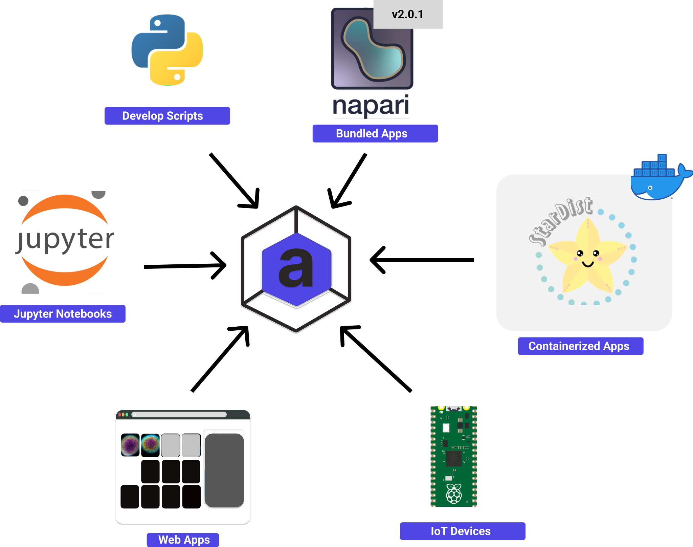
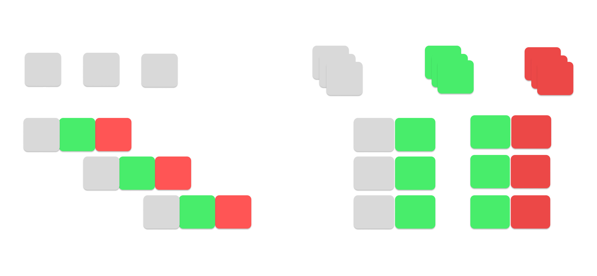

## The problem

Bioimage acquisition and analysis have advanced enormously in the last decade. Light-sheet
microscopes image whole organisms at cellular resolution, super-resolution methods resolve
structures at the nanometer scale, and deep learning solves problems like cell segmentation that
were out of reach for years. Smart microscopy closes the loop: analysis decides, during the
experiment, what the microscope acquires next.

These advances came with a cost. No single program like ImageJ does it all any more. A modern
analysis uses several tools, each grown to solve one problem on one setup, often on specific
hardware. Each is very good at its job and hard to combine with the others. Some are stuck on the
desktop, others were built for the cloud, and metadata gets lost as data moves from one to the
next.

The data is fragmented too: terabytes in many formats, spread over local disks, network drives and
cloud storage, in folder structures nobody else understands. Keeping track of it, sharing it and
reproducing a result is work in itself. Setups like smart microscopes need programming experts to
run them in real time, and everyone else is left reading about the results in papers.

We built Arkitekt to make this kind of work manageable, and fun, again.

## Guiding principles

**Tools know best.** Specialized tools will not go away, and forcing them to do what they were not
built for helps nobody. Arkitekt connects existing tools so that whoever designs a workflow can pick
the best one for each step, and it leaves the computation to those tools and the hardware they run
on.

**A middleman, not direct links.** Tools that were never designed to work together should not have
to talk to each other directly. Each connects to a central [hub](/docs/concepts#the-hub) instead,
which brokers between them, lets you design workflows across several apps, and runs those workflows
in [real time](#everything-everywhere-all-at-once) rather than in batches.

**Data is king.** Machine-readable data is the basis of FAIR science, so the hub is also a
multi-user data store for everything a lab produces, over its whole lifecycle. You can explore data
while it is being produced, the hub records which tool did what to it and when, and you can share it
and comment on it with colleagues without losing its provenance.

**Open and modular.** Arkitekt is open source and built from parts. A standard installation will be
enough for many labs, and we hope others take parts out, replace them and combine them with their
own tools.

## A Platform for Humans [#a-platform-for-humans]

**Arkitekt is built for people.** Every interface and every design decision starts from a person who
wants to understand their data and stands behind the results.

AI agents, language models that call tools and chain analyses together, are increasingly capable,
and some are now used to design experiments and write papers. We do not ignore this, but we do not
want agents to take over the scientific process. The reason is **scientific provenance**: science
needs to say *who* asked a question, *why*, and *how* the answer was produced. An AI agent that
starts analyses on its own brings two risks:

- **Data access.** An unsupervised agent with broad access can read, move or expose data it was
  never meant to touch, including sensitive or unpublished results.
- **Data pollution.** An agent that writes back into your data store can fill it with
  low-quality, hallucinated or unverifiable results, and a polluted record is very hard to clean.

So Arkitekt follows one rule: **every task is started by a person and can then be delegated.** A
person starts the task and takes responsibility for it, and may then hand it to an AI agent to carry
out. A task never originates from an AI agent on its own. The person is always the root of the
provenance chain, so someone is accountable for every result that touches your data.

Started by a person does not mean started in the UI: you can start tasks through the API, too. You
can also fake it, but then any data pollution or access problem that follows is on you. How we use AI
when building the platform, always under supervision, is described in [AI?](/docs/concepts/ai).

## Arkitekt the Middleman [#arkitekt-the-middleman]

For **users**, Arkitekt is meant to work for non-experts, and everyone is a non-expert in most of
bioimage analysis. Connecting ImageJ to napari should be as easy as connecting ImageJ to a local
Python script, a microscope to a deep-learning model in the cloud, or a pipetting robot to a coffee
machine, without having to care about the infrastructure in between.

For **developers**, scientific analysis keeps changing, and today's solution will not fit tomorrow's
data. Experts know their problem best and need tailored solutions. Arkitekt should not make them
adopt a rigid platform or move everything to the cloud. They keep the tools and languages they know,
and Arkitekt runs their code on the hardware of their choice.

Arkitekt itself is only the backbone in between. It leaves the computation to the apps, which lets
apps written in different languages and running on different hardware work together and share data.
In the rest of these docs, this middleman is the [hub](/docs/concepts#the-hub).

## Everything everywhere, all at once [#everything-everywhere-all-at-once]

We generate more data than we can process in time. Often that means weeks of waiting for processing,
and more weeks before the results are analysed. Arkitekt is built so that you can analyse data while
it is being generated, without the developer having to do much for it.

### Real-time workflows

The same Arkitekt workflow runs **post hoc** on data you already have and **in real time** on data
as it is generated. That takes streaming instead of batch analysis: each item is processed as soon
as it arrives. Results come sooner, and the immediate feedback makes paradigms like smart microscopy
possible. The technical side, stateful apps that load a model once instead of once per image, is
laid out in the [Nextflow comparison](/docs/concepts/comparisons/nextflow#execution-model).

### Facing bottlenecks

Real-time analysis runs into bottlenecks: old hardware, a slow deep-learning model, a slow or
high-latency network. Arkitekt gives you ways to monitor and fix them while the analysis is still
running, so it can stay real time. By default a workflow's apps can run on several computers. For
workflows that cannot afford network latency, one app can run the whole workflow itself; see
[Local workflows](/docs/guides/using/local-workflows).
