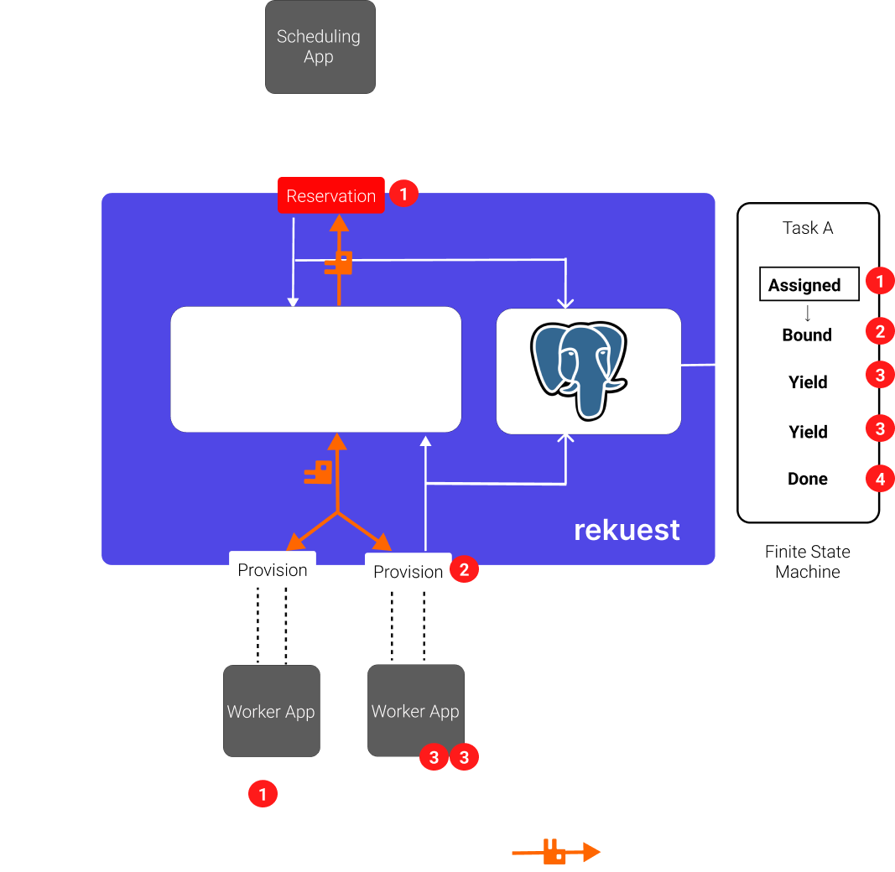

A task is created every time you, a script or a workflow runs an action. It belongs to the **user
and organization** that started it and runs with their permissions. It keeps an **event history**
(queued, started, progress, logs, yields, end), and it can stream results and be cancelled. A
workflow calls actions as **child tasks** of its own, so a run is a tree, and every data change along
the way is attributed to it ([Provenance](/docs/concepts/provenance)).

The steps from assignment to result are traced in [One task, end to end](/docs/concepts#one-task-end-to-end).
Once Rekuest has routed a task to an agent, the task is **bound**: the platform knows where it runs,
so it can be cancelled and the agent's death can be noticed. The agent reports `STARTED` before it
calls the function, and the task ends in exactly one terminal state.

## States [#states]

| State | Meaning |
|---|---|
| **Queued / assigned** | Routed, waiting for its agent. A task nobody has picked up yet is safe to deliver again. |
| **Running** | The agent has reported `STARTED` |
| **Paused** | Paused by a person, or holding itself with a question for a person (`task.hold`) until someone resumes or cancels it |
| **Completed** | Returned its result *(terminal)* |
| **Failed / critical** | Ended with an error *(terminal)* |
| **Cancelled** | Stopped on request *(terminal)* |
| **Interrupted** | Stopped by an interrupt, a harder request than cancel *(terminal)* |
| **Lost** | Its agent died while it ran, so how it ended is unknown *(terminal)* |

A task ends **lost** when its agent disappears for longer than the grace window, or at once when a
new process takes over the agent. Lost is neither success nor failure: the work may have finished,
half-finished or never started.
The event records what is known (whether it started, its last progress, the action's claimed
[effects](/docs/develop/patterns/durability#effects)). The platform does not run it again;
whoever called decides. Lost is final: a result that turns up later is kept in the history but does
not change the state.

## Cancellation [#cancellation]

Any task can be cancelled at any time by its id. The request goes to the agent running it, and the
task ends as cancelled once the agent confirms. Unlike a plain message queue, Arkitekt treats this as
a core feature: a person must always be able to stop a running experiment
([A platform for humans](/docs/concepts/philosophy#a-platform-for-humans)).

<Callout type="warn" title="Cancellation needs the code's cooperation">

Code stops only where it can: in Python, an `async` action at its next `await`, a synchronous one
only where it checks for cancellation. Hardware needs its own watchdog. See
[Disconnect policy](/docs/develop/python/durable-execution#disconnect-policy).

</Callout>
