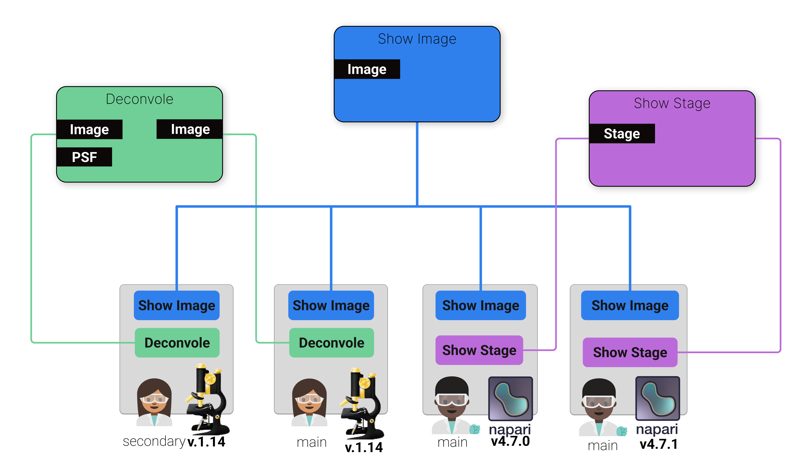
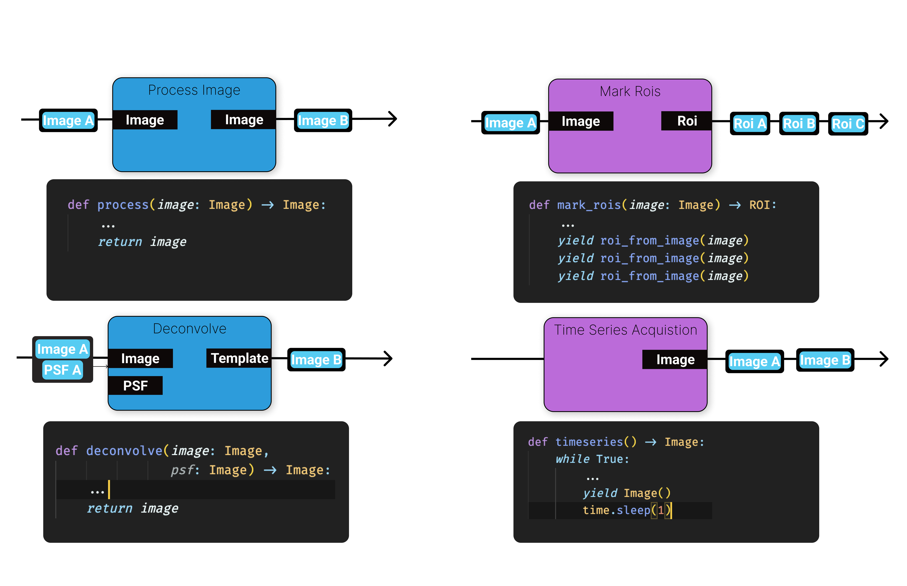
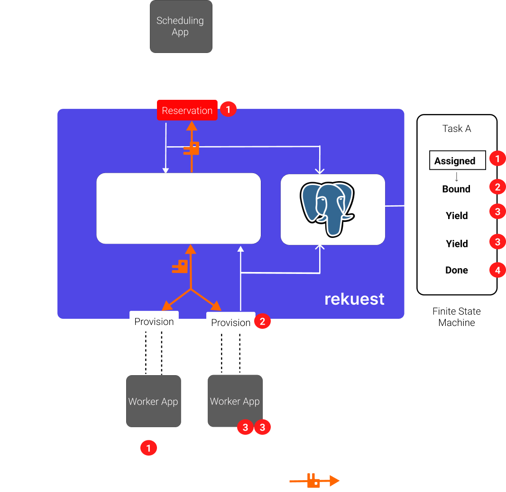

Pointing at a linked term anywhere in the docs shows its one-line definition. This page covers what
a one-liner cannot: how the terms relate and how they behave. For the bigger picture, see
[How Arkitekt works](/docs/concepts).

## How the terms relate [#how-do-these-elements-relate]

| Term | Is | Example |
|---|---|---|
| **Action** | *what* can be done, defined by its inputs and outputs | "Segment Cells: Image → LabelMask" |
| **App** | a program that can offer implementations | the `stardist` plugin, version 0.3 |
| **Implementation** | *how* an app does an action | stardist's `segment_cells` function |
| **Agent** | a running instance of an app that serves its implementations | stardist running on the GPU server |
| **Task** | one run of an action, routed to an agent | "segment image 42", started by you at 10:14 |

An action is an abstract contract. Apps implement it, agents are running copies of those apps, and
a task is one call that the hub routes to an agent. You assign a task to an action, never to a
machine, so the call keeps working when the app behind it changes.

## What is an app? [#what-is-an-app]

An app can be Orkestrator, Fiji with the Arkitekt plugin, a website, a Python script, a robot or a
sensor. Any code that reads or writes your data has to be an app, because the hub only answers
authenticated apps. The first time an app connects, you approve it and the
permissions (scopes) it asks for through OAuth2, the flow behind "log in with Google". From then on
the hub knows which app, in which version, acts for which user. Apps are
[versioned](/docs/get-started/deployment/versioning) independently of the hub.

An app may expose actions, but it does not have to: an app that only displays data is still an app.
Standalone apps and plugins are described in [Apps](/docs/guides/apps).

## Apps vs services [#apps-vs-services]

**Services** are the parts the hub is built from: [Rekuest](/docs/develop/internals/rekuest),
[Mikro](/docs/develop/internals/mikro), [Fluss](/docs/develop/internals#fluss) and the others. They
store and retrieve data and route work, but they do no analysis and are not used directly by people.
**Apps** do the analysis, and use services to read inputs and store results. An app lists the
services it requires in its [manifest](/docs/develop/reference/manifest), you see them when you approve it,
and it only works with a hub that runs them.

## What is an action? [#what-is-an-action]

An action is something the platform can do for you, defined only by its typed inputs and outputs,
its [ports](#port). It can be a computation (a maximum projection, a Gaussian filter) or a request to
a person (select a file, label an image).

An action is not bound to an implementation: Fiji and napari can each implement the same "Show"
action their own way. Callers depend only on the action, so you can pick the app you prefer, and a
developer can change an app's code without breaking callers while the inputs and outputs stay the
same.

### Actions can stream [#action-can-establish-streams]

A function action returns one result. A generator action **yields** results over time, and each one
reaches the caller as soon as it is produced. In a [workflow](#workflow), the next node starts on the
first item instead of waiting for the last, which is what lets a workflow process images while they
are still being acquired.

## What is an implementation? [#what-is-an-implementation]

ImageJ, napari and a Python script could each do "Maximum Intensity Projection" differently; each
is an implementation of that one action. Implementations always belong to an app, and exist per user
who runs it, which lets the platform pick the best fit for a task.

As a developer you rarely deal with either term. When you decorate a function with `@app.action`,
the SDK reads its signature and docstring and declares the implementation. If no matching action
exists yet, the hub creates one.

## Agent [#agent]

An agent is the process that holds a connection to Rekuest, receives tasks, runs them and reports
back. `arkitekt run` on your laptop is an agent, and so is a plugin container started by Kabinet or a
Qt application with a connected MagicBar. One app can run as several agents, on different machines or
for different users, and the platform picks one when it routes a task. An agent also owns the app's
live [state](/docs/develop/python/state-lifecycle).

When an agent dies, its running tasks end [lost](#states), except workflow tasks, which the next
process resumes from the agent's journal. A restarted agent keeps its name. See
[Durable execution](/docs/develop/patterns/durability).

<Callout type="info" title="Not an AI agent">

An AI assistant that calls actions is a *caller*, like a person or a script. "Agent" on its own
always means a running app instance.

</Callout>

## Task [#task]

A task is created every time you, a script or a workflow runs an action. It belongs to the **user
and organization** that started it and runs with their permissions. It keeps an **event history**
(queued, started, progress, logs, yields, end), and it can stream results and be cancelled. A
workflow calls actions as **child tasks** of its own, so a run is a tree, and every data change along
the way is attributed to it ([Provenance](/docs/concepts/provenance)).

The steps from assignment to result are traced in [One task, end to end](/docs/concepts#one-task-end-to-end).
Once Rekuest has routed a task to an agent, the task is **bound**: the platform knows where it runs,
so it can be cancelled and the agent's death can be noticed. The agent reports `STARTED` before it
calls the function, and the task ends in exactly one terminal state.

### States [#states]

| State | Meaning |
|---|---|
| **Queued / assigned** | Routed, waiting for its agent. A task nobody has picked up yet is safe to deliver again. |
| **Running** | The agent has reported `STARTED` |
| **Paused** | Paused by a person, or holding itself with a question for a person (`task.hold`) until someone resumes or cancels it |
| **Completed** | Returned its result *(terminal)* |
| **Failed / critical** | Ended with an error *(terminal)* |
| **Cancelled** | Stopped on request *(terminal)* |
| **Interrupted** | Stopped by an interrupt, a harder request than cancel *(terminal)* |
| **Lost** | Its agent died while it ran, so how it ended is unknown *(terminal)* |

A task ends **lost** when its agent disappears for longer than the grace window, or at once when a
new process takes over the agent. Lost is neither success nor failure: the work may have finished,
half-finished or never started.
The event records what is known (whether it started, its last progress, the action's claimed
[effects](/docs/develop/patterns/durability#effects)). The platform does not run it again;
whoever called decides. Lost is final: a result that turns up later is kept in the history but does
not change the state.

### Cancellation [#cancellation]

Any task can be cancelled at any time by its id. The request goes to the agent running it, and the
task ends as cancelled once the agent confirms. Unlike a plain message queue, Arkitekt treats this as
a core feature: a person must always be able to stop a running experiment
([A platform for humans](/docs/concepts/philosophy#a-platform-for-humans)).

<Callout type="warn" title="Cancellation needs the code's cooperation">

Code stops only where it can: in Python, an `async` action at its next `await`, a synchronous one
only where it checks for cancellation. Hardware needs its own watchdog. See
[Disconnect policy](/docs/develop/python/durable-execution#disconnect-policy).

</Callout>

## Organization [#organization]

An organization holds users, data and configuration. It is usually a lab, a facility or an
institute, and one hub can host many side by side. It is a logical boundary, not a machine.

### The hard boundary [#the-hard-boundary]

The organization is the one boundary that always holds. Data never crosses from one organization to
another, whatever else you configure. That is what makes it safe for a facility to run one hub for
many independent groups.

### Open by default, within your organization [#open-by-default-within-your-organization]

Inside an organization, every user can see their colleagues' data by default, because having to
share every dataset before anyone can build on it slows science down. On top sits **role-based access
control**: administrators can restrict who may read, write, run or administer a resource. See
[Security Measures](/docs/concepts/security#security-measures). Every audit record also names the
organization, next to the user and the app ([Provenance](/docs/concepts/provenance)).

## Workflow [#workflow]

A workflow is a graph of nodes. Each node runs an action, and each edge carries data from an output
port to a matching input port. A workflow names actions, not apps, so the same blueprint can run in
another lab on different apps; a node that no installed app implements shows in yellow until one
does. Workflows are stored as JSON and run by [Fluss](/docs/develop/internals#fluss). To build one,
follow [Your first workflow](/docs/guides/first-workflow).

### Workflows are nodes [#workflows-are-just-nodes]

Every workflow has exactly one `Input` and one `Output` node. What you connect to `Input` becomes a
parameter, what you connect to `Output` becomes a result. So a workflow is itself an action: you can
nest workflows, and run one on your data like any other action.

### Data flows as a stream [#data-flows-as-a-stream]

Each node processes an item as soon as it arrives and passes the result on, without waiting for the
rest. Together with [streaming actions](#action-can-establish-streams), this lets a workflow work on
data that is still being generated, such as images from a running acquisition.

### Who runs a workflow

You assign a workflow run to an app that becomes its **scheduler** and calls the other apps.
Intermediate results are stored centrally and tracked for provenance. When that round trip costs too
much, an app can run the workflow itself and keep intermediate data in memory; see
[Local workflows](/docs/guides/using/local-workflows).

## Port [#port]

A port is one typed input or output of an action. It has a `key`, a kind, a flag saying whether it
may be empty (nullable), and an optional label and description. Kinds are:

- **Scalars**: strings, integers, floats, booleans and enums, sent as values.
- **Containers**: lists, dictionaries and unions of other kinds.
- **Models**: small records of named values, sent as values.
- **Structures**: large or app-specific data, sent by reference (below).

Ports decide what a caller may pass, which widget Orkestrator shows, and which actions can be wired
together. How Python types map to ports is in [Types & data](/docs/develop/python/types).

## Structure [#structure]

Images, volumes and tables are too large to send through a task. A structure is a type that travels
**by reference**: only an id crosses the network, and the receiving side resolves it.

- **Service structures** live in a data service such as Mikro, which every app can reach. Any app
  with the matching client can resolve them.
- **In-memory structures** stay on the agent that made them. The next action on the same agent gets
  the object back, but no other app can resolve the reference, and it is gone when the agent stops.

### Shrink and expand [#shrink-and-expand]

Turning an object into its reference is **shrinking**, turning it back is **expanding**. A service
structure shrinks to its id in the service, and expanding fetches it. An in-memory structure is put
on the agent's local shelf and expanded from there.
