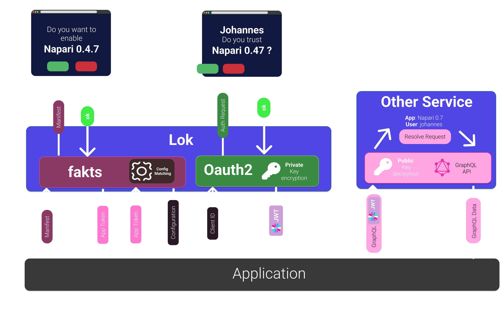
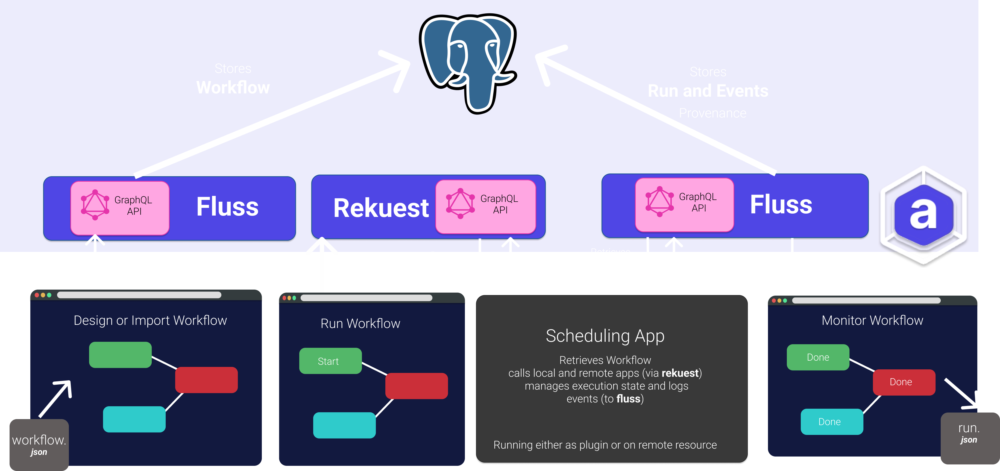
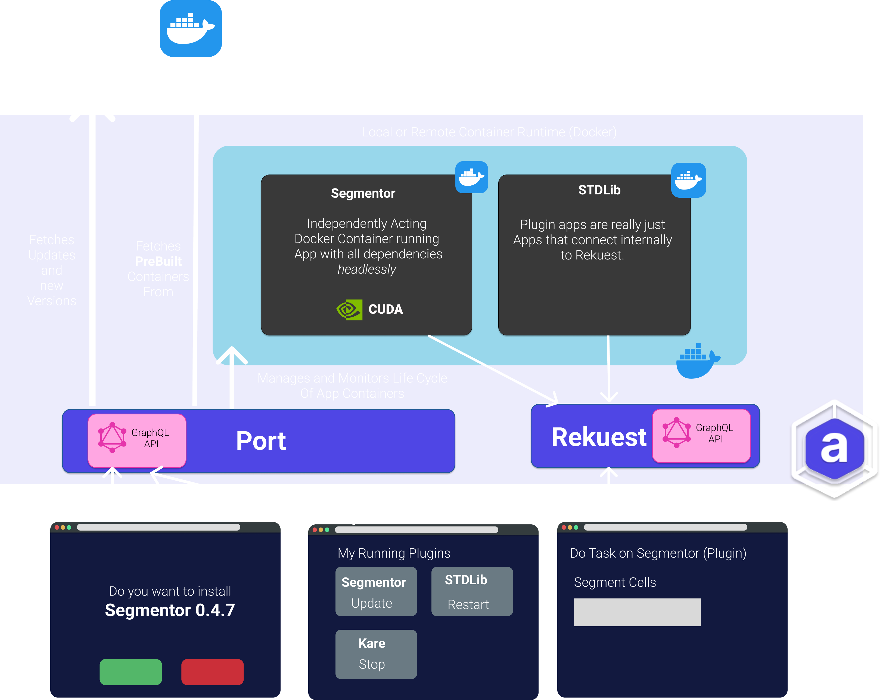

import { GithubRepo } from "@/components/docs";

An Arkitekt server is a set of independent services. Each owns one concern, has its own database and
GraphQL API, and can be left out if you do not need it. Computation does not happen here: it runs in
apps, and the services store, route and describe their work.

| Service | Concern |
|---|---|
| [Lok](#lok) | Users, apps, login and configuration |
| [Rekuest](/docs/develop/internals/rekuest) | The catalogue of actions and the assignment of tasks to agents |
| [Fluss](#fluss) | Workflow designs and the logs of their runs |
| [Mikro](/docs/develop/internals/mikro) | Microscopy data: images, metadata and their lineage |
| [Kraph](/docs/develop/internals/kraph) | The knowledge graph and provenance |
| [Kabinet](/docs/develop/internals/kabinet) | The app store: installing and running plugin apps |

These services are newer or optional. You can use them, but they are less tested and may change:

| Service | Concern |
|---|---|
| [OmeroArk](#omeroark) | Access to an OMERO server |
| [Kluster](#kluster) | Dask clusters on demand |
| [Port](#port) | The earlier app store, superseded by Kabinet |

## Design principles [#design-principles]

- **Containerized.** Each service is a web server in its own container, deployable with Docker or
  Kubernetes.
- **GraphQL.** Each service has a GraphQL API with subscriptions for live updates (see
  [GraphQL](/docs/develop/internals/graphql)).
- **Independent.** Services do not call each other. They can evolve on their own, be combined freely
  and scale separately.
- **Tokens checked locally.** Each service verifies the JWT a request carries on its own, without
  asking Lok (see [Identity & Access](/docs/concepts/security/identity)).
- **Postgres** is the default database.
- **Configured from files and environment variables**, generated when you set up a server.
- **Logs go to standard output.**

Most services are Python with Django and Strawberry GraphQL, built on the shared
[backend libraries](/docs/develop/internals/backend-libraries). Rekuest's task assignment runs in
a separate Rust program, takt, because agent traffic must not wait behind API work. A service with
other needs can use another stack, as long as it follows the principles above.

## Lok [#lok]

<GithubRepo url="https://github.com/arkitektio/lok-server" title="Lok"/>

Lok manages users and apps. It registers and authorizes apps through OAuth2 and OpenID Connect, hands
them their configuration through [Fakts](/docs/develop/internals/service-discovery), and issues
signed JWTs. Every other service verifies those tokens with Lok's public key, without asking Lok. It
also holds user profiles and comments.

## Fluss [#fluss]

<GithubRepo url="https://github.com/arkitektio/fluss-server" title="Fluss"/>

Fluss stores workflows and the records of their runs. It does not execute them: a scheduler app runs
a workflow by calling the actions its nodes name (see
[Workflow](/docs/concepts/workflows) and
[Durable execution](/docs/develop/patterns/durability)).

A workflow designed in Orkestrator is stored as JSON that lists its nodes and their connections. You
can edit the JSON, but it is not meant to be read by people; use Orkestrator. Web components render
a stored workflow, as on these pages.

When an app runs a workflow, it creates a run in Fluss and logs every event of the execution there.
The log holds references to the data, not the data itself, and the processing steps applied to it.
You can filter a log by time, node and status, and view it in Orkestrator.

## OmeroArk [#omeroark]

<GithubRepo url="https://github.com/arkitektio/omero-ark-server" title="OmeroArk"/>

OmeroArk is a stateless gateway that puts a GraphQL API in front of an OMERO server's Blitz API. It
keeps no copy of the data: what you see is what OMERO holds. It uses Arkitekt's login once you have
linked your OMERO account to your Arkitekt account. Like the OMERO web client, it cannot upload data
to OMERO.

## Kluster [#kluster]

<GithubRepo url="https://github.com/arkitektio/kluster-server" title="Kluster"/>

Kluster is a stateless gateway to [Dask-Gateway](https://gateway.dask.org/en/latest/), which starts
Dask clusters on demand on backends such as SLURM, PBS, Kubernetes and Hadoop. Kluster wraps its API
in GraphQL. Because it keeps no state, it scales horizontally.
[Kluster-Gateway](https://github.com/arkitektio/kluster-gateway-server), a modified Dask-Gateway with
a JWT plugin, lets Arkitekt logins reach Dask-Gateway without Kluster.

Kluster is early in development. It works with local clusters and with SLURM (which needs extra
configuration), and has not been tested with the other backends. If you use Dask-Gateway and want to
try it, get in touch.

## Port [#port]

<GithubRepo url="https://github.com/arkitektio/port-server" title="Port"/>

Port was the first app store: it installed containerized plugin apps and ran them on the server.
[Kabinet](/docs/develop/internals/kabinet) has replaced it in the standard deployment. Port still works
and can run alongside Kabinet, but Kabinet is the recommended choice.

