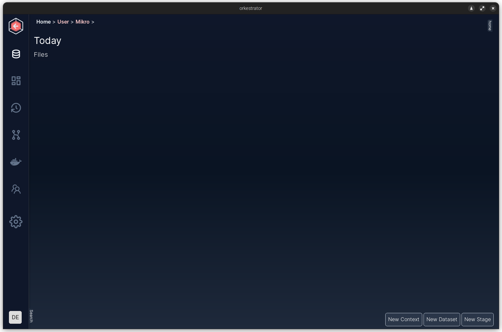

import { OrkestratorGrid } from "@/components/docs";

Orkestrator is the main user interface of Arkitekt. You use it to inspect and comment on your data,
run actions, and build and run workflows. To sign in for the first time, follow
[Connect with Orkestrator](/docs/get-started/join/connect).

## Desktop application

Orkestrator is a desktop app for Windows, macOS and Linux, built on Electron. There is no browser
version. It connects to any hub you have access to: on your own machine, in your lab network, or
across the internet through the [mesh](/docs/concepts/security/mesh).

<OrkestratorGrid pokket />

As a desktop app it can do things a web page cannot:

- **Find hubs for you.** It connects to hubs you reach through the mesh, without you entering an
  address, and you can switch between hubs at any time.
- **Connect to hubs without HTTPS.** Useful on a local network where certificates are not
  available. Do not connect to such hubs when they are exposed to the internet; see
  [Security](/docs/concepts/security#security-measures).
- **Use your GPU and memory.** The volume viewer and other heavy views render on your machine
  rather than in a browser sandbox.

Planned: automatic updates, and importing and exporting data without
[Gucker](/docs/guides/apps/gucker).

<Callout type="info" title="Why not a website?">

A web page served from the internet may not talk to a server in your lab network, to a hub without
a valid certificate, or to hardware on your machine. A bioimage analysis frontend needs all three,
so Orkestrator is a desktop app.

</Callout>

## The sign-in screen

With no account added on this computer, Orkestrator opens on the sign-in screen:

- **Sign in with go.arkitekt.live** opens your browser to sign in and approve the app. While
  Orkestrator waits, **Open browser again** and **Cancel** replace the button.
- **More Options** holds **Connect to Custom Coordination Server**, for accounts kept by your
  institute instead of go.arkitekt.live, and **Diagnose connection**, for when signing in fails.

The accounts you add stay on this computer, so you sign in once. After signing out, the screen
shows **Welcome back** with your accounts as cards, and a plus to add another.

On first start your firewall may ask whether Orkestrator may use the network. Allow it.

## The interface

| Where | What is there |
|---|---|
| **Sidebar** (left edge) | The main sections of the app. Your account sits at the bottom, with sign out. |
| **Main view** (center) | The data, workflow or run you are working with. |
| **Side panels** (left and right of the main view) | Left panels mostly search; right panels configure the view or show details. |
| **Action buttons** (bottom right) | The most important actions for what you are looking at. They change with the item, and include actions of connected apps. |

Right-click an item for the actions on it, or drag one item onto another to see what you can do
with both. [Upload your images](/docs/guides/using/upload-data) shows how.
