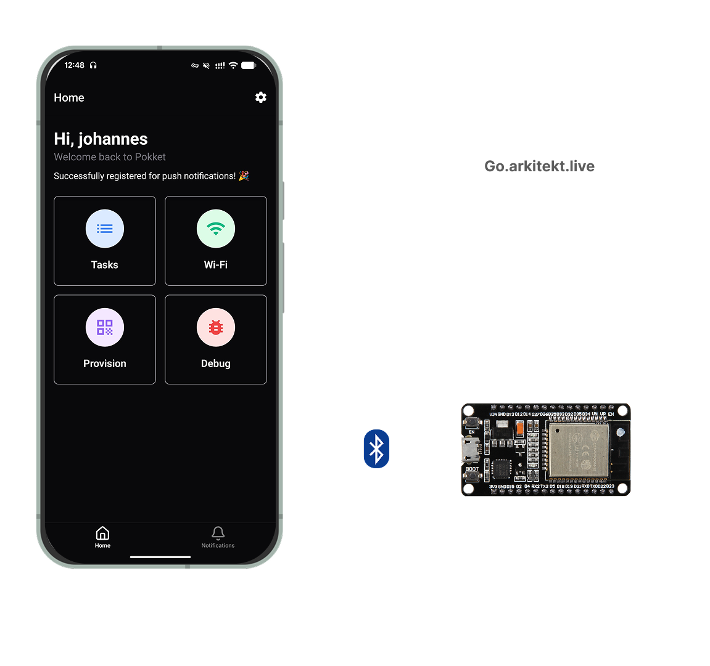

**Pokket** is the mobile companion to [Orkestrator](/docs/guides/apps/orkestrator), for the times you
are at the microscope, at the bench or away from your desk. It talks to the same hub with the same
account. It has no workflow editor and no image viewer; those stay in Orkestrator.

Pokket signs in through `lok` like every other Arkitekt app, so on your phone you can see and do
exactly what your account may see and do on the hub.

## What you can do with it

| Feature | What it does |
|---|---|
| **Tasks** | Lists your latest tasks from the `rekuest` service, so you can check whether a long-running analysis finished or failed. |
| **Device provisioning** | Sets up ESP32 devices over Bluetooth Low Energy with the **Improv Wi-Fi** protocol: it sends the Wi-Fi credentials (eduroam included) and an Arkitekt connection token. The device then connects, registers its actions and shows up as an app in Orkestrator. |
| **Wi-Fi profiles** | Saves standard and eduroam profiles, so you can provision a shelf of devices without retyping credentials. |
| **Mesh** | Joins your organization's [mesh](/docs/concepts/security/mesh) once you approve it, so services that only live on the mesh are reachable from your phone. |

For the firmware side of a device, see
[Your first embedded device](/docs/develop/first-device).

<Callout type="info" title="Provisioning needs Bluetooth">

Your phone needs Bluetooth Low Energy, and Pokket needs permission to use it.

</Callout>

### The mesh on your phone

Pokket runs its own mesh node inside the app. It needs no VPN permission and no separate Tailscale
app. The **Mesh** screen shows the node, the machines it sees and which services it carries, and
lets you switch it off.

<Callout type="warn" title="No live video over the mesh">

Over the mesh, regular requests and live updates work, but WebRTC media (LiveKit) does not. Live
video streams will not play on the phone over the mesh.

</Callout>

## Install

| Platform | Where | Notes |
|---|---|---|
| **Android** | [`pokket.apk`](https://github.com/arkitektio/pokket/releases/latest/download/pokket.apk) | Open the link on the phone and install it (allow installs from your browser when asked). The [latest release](https://github.com/arkitektio/pokket/releases/latest) page has it too. |
| **iPhone / iPad** | [TestFlight](https://testflight.apple.com/) | Ask a maintainer to add you as a tester; you get an e-mail invite. Install TestFlight from the App Store and accept it. |

**Updates install themselves.** Most releases change only the app's JavaScript and arrive over the
air: Pokket downloads them on launch and offers a restart. You only need a new APK or TestFlight
build when a release changes the native app; the release notes say so.

## Development

```bash
pnpm install
pnpm expo start
```

The [repository README](https://github.com/arkitektio/pokket) covers development clients, building
the mesh sidecar and how releases are made.

Pokket is built with React Native (Expo), NativeWind, Expo Router, Apollo Client (GraphQL) and
`react-native-ble-plx`. It is MIT licensed.
