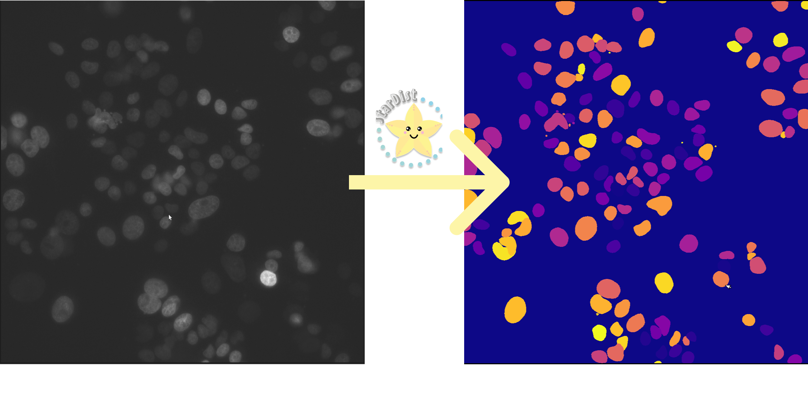

You build a workflow that takes the image open in Fiji or napari, segments the nuclei with a
[StarDist](https://github.com/stardist/stardist) model in the `segmentor` app, and shows the result
back in the same viewer. The model runs wherever `segmentor` runs, so a laptop without a GPU can use
the GPU of a server in the lab.

<Prerequisites>

- You can build and run a workflow: [Your first workflow](/docs/get-started/next-steps/first-workflow)
- The [segmentor](https://github.com/arkitektio-apps/segmentor) app installed and running on your hub
- Fiji with the [ImageJ plugin](/docs/guides/apps/imagej-plugin), or napari with
  [mikro-napari](/docs/guides/apps/mikro-napari), connected to the same hub
- Ideally a CUDA-capable GPU on the machine that runs segmentor. On the CPU, prediction works but is
  slow.

</Prerequisites>

## 1. Test the model

`segmentor` is packaged as a container with its deep learning dependencies, so nothing needs to be
installed on your own computer. It comes with a pretrained model.

Run the **Segment Fluo2** action on an image on your hub, as you would any other action. If a mask
of the nuclei comes back, the app works.

## 2. Build the workflow for Fiji

The workflow has three nodes, all actions you already have:

1. **Upload Image** (ImageJ plugin): takes the active image in Fiji and stores it on the hub.
2. **Segment Fluo2** (segmentor): predicts the nuclei mask.
3. **Show Image** (ImageJ plugin): loads the mask into Fiji.

Build it in the Workflow Designer and save it, as in
[Your first workflow](/docs/get-started/next-steps/first-workflow). Then open an image in Fiji
and run the workflow from Orkestrator.

<video autoPlay muted loop controls className="rounded-md" width={"100%"}>
  <source src="/docs/introduction/advanced/fiji_segmentation.webm" />
</video>

## 3. Build the workflow for napari

The napari version is the same workflow with napari's actions at both ends:

1. **Upload Layer** (mikro-napari): stores the active layer on the hub.
2. **Segment Fluo2** (segmentor).
3. **Show on Napari** (mikro-napari): shows the mask as a new layer.

Save it and run it the same way, with an image open in napari.

<Callout type="info" title="One workflow for both viewers">

The two workflows differ only in their first and last nodes. You could build one that uses generic
upload and show actions and let the person running it choose the viewer.

</Callout>

## Next

To segment with a model trained on your own data, see
[Train a deep learning model](/docs/legacy/training).
